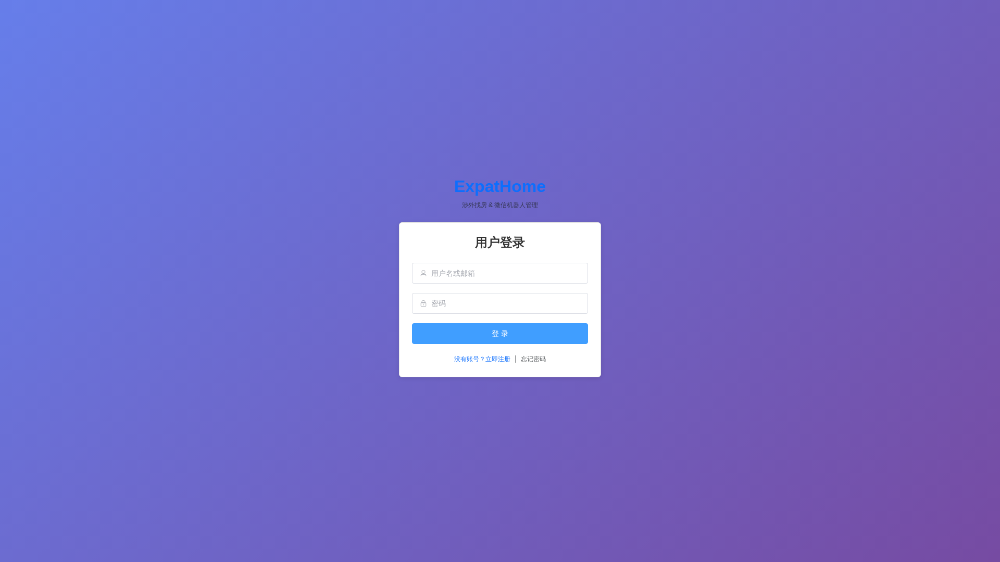
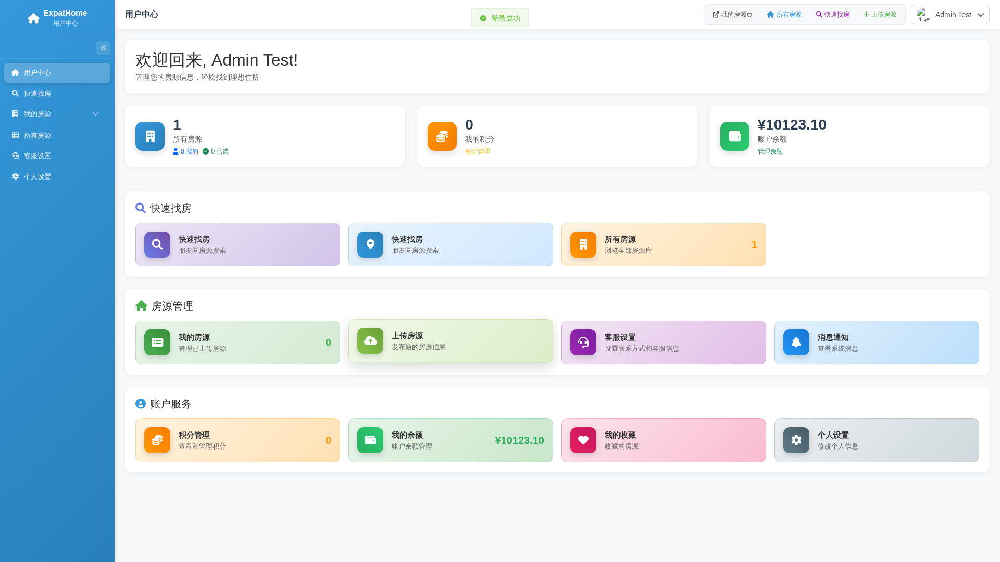
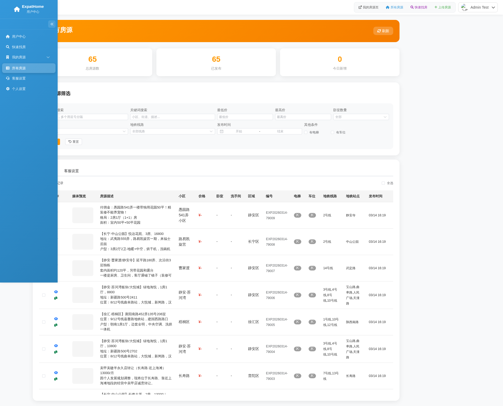

# ExpatHome · 涉外房产与 AI 运营平台

ExpatHome 是面向涉外租售业务的房源、客户和内容运营系统，覆盖房源管理、地图检索、客户跟进、朋友圈内容解析、SEO 运营、数据导入导出和多渠道连接，适合房产经纪或本地化运营团队二次开发。

## 主要功能

- 房源录入、编辑、上下架、图片与小区信息管理。
- 地图搜索、小区匹配、POI 校验和地理位置展示。
- 客户线索、收藏、咨询、跟进状态和运营统计。
- 朋友圈内容解析、结构化整理和素材管理。
- SEO 内容、站点配置、报表和批量导入导出。
- 管理员、员工和用户权限，以及登录、会话和操作日志。
- 邮件、短信、对象存储、Redis、地图和第三方 AI 可选接入。

## 产品界面







## 技术架构

- 服务端：Node.js、Express、MySQL、Redis、Bull。
- 前端：Vue/Vite 构建产物，由服务端提供静态访问。
- 安全：Helmet、限流、会话、JWT、输入校验和密码哈希。
- 运行：PM2 或 systemd，Nginx 负责 HTTPS 和反向代理。

## 环境要求

- Node.js 20+、npm 10+、MySQL 8.0。
- 使用队列或分布式会话时需 Redis 6+。
- 生产环境建议配置 Nginx、HTTPS、对象存储和 SMTP。

## 本地安装

```bash
git clone https://github.com/CharlesYin1204/seo-ai-expatshome.git
cd seo-ai-expatshome
npm ci
cd client && npm ci && cd ..
cp .env.example .env
```

编辑 `.env`，至少填写数据库、会话密钥和站点地址。创建数据库并导入项目数据库结构或执行对应迁移后启动：

```bash
npm run dev
```

服务端默认端口为 `3000`；只启动服务端可执行 `npm run server:dev`。

## 核心配置

| 配置 | 作用 | 是否必需 |
| --- | --- | --- |
| `DB_HOST`、`DB_PORT`、`DB_USER`、`DB_PASSWORD`、`DB_NAME` | MySQL 连接 | 是 |
| `SESSION_SECRET`、`JWT_SECRET` | 会话和令牌签名 | 是 |
| `APP_URL`、`SITE_URL`、`PORT` | 站点地址和端口 | 是 |
| `REDIS_HOST`、`REDIS_PORT` | 队列和 Redis 会话 | 按功能 |
| `AI_API_BASE`、`AI_API_KEY` | AI 服务 | 按功能 |
| `AMAP_API_KEY`、`BAIDU_MAP_KEY` | 地图与地理编码 | 按功能 |
| `MAIL_*`、`SMS_*` | 邮件和短信 | 按功能 |

密钥只保存在服务器环境文件中，不要提交 `.env`、数据库备份、上传目录或访问凭据。

## 构建与测试

```bash
npm run client:build
npm run lint
NODE_ENV=production npm start
```

上线前还应验证登录、房源增删改查、地图、小区匹配、上传、导入导出和权限隔离。

## 生产部署

1. 安装 Node.js、MySQL、Redis 和 Nginx，并创建独立系统用户。
2. 拉取代码，执行根目录及 `client/` 中的 `npm ci`。
3. 创建权限为 `600` 的生产环境文件，填写数据库和强随机密钥。
4. 创建数据库并导入结构或执行迁移，限制数据库用户权限。
5. 执行 `npm run client:build` 生成前端资源。
6. 使用 `npm start` 验证服务，再交由 PM2 或 systemd 托管。
7. Nginx 反向代理到 `127.0.0.1:3000`，配置 HTTPS、上传大小和超时。
8. 配置 MySQL 定时备份、日志轮转和健康检查，并完成恢复演练。

更新时先备份数据库和环境文件，再拉取代码、执行 `npm ci`、重新构建并滚动重启。

## 项目结构

- `server/`：Express API、业务服务、配置和任务。
- `client/`：前端源代码。
- `server/public/`：构建后的公共资源。
- `database/`：数据库结构与维护脚本。
- `scripts/`：数据导入、POI 和运维脚本。
- `public/uploads/`：本地上传目录，生产数据不纳入 Git。

## 常见问题

- 数据库连接失败：检查账号权限、防火墙和数据库名称。
- 队列不运行：确认 Redis 可用并检查队列日志。
- 图片无法访问：检查目录权限、对象存储和 Nginx 路径。
- 地图无数据：确认密钥、域名白名单和坐标格式。

## 联系方式

微信：`charlesyin6015`
